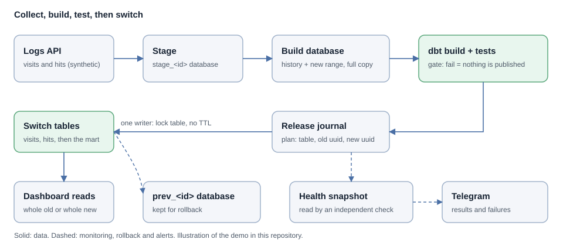

# Metrika → ClickHouse: whole-release publishing

A small, runnable pattern for publishing analytics data so a dashboard **never sees half a
load**. New data is built and tested in a separate database, journaled, and only then
switched in. If the switch is interrupted, recovery finishes it without swapping anything back.

Everything here runs on **synthetic data**: a stand-in for the Yandex Metrika Logs API and
Reporting API generates visits and hits. No client code, data, counters or domains are included.



## The problem

- A scheduled load can finish and still leave a report reading an incomplete dataset
  (new visits next to old hits).
- When numbers freeze, nobody can tell a broken pipeline from a website that stopped
  sending events.
- A test that checks the mart against raw data built with the same join will happily
  report "0 gaps" for data that never arrived.

## Try it

Requirements: Docker, Python 3.10+.

```bash
make install        # virtualenv + dependencies (includes dbt-clickhouse)
make demo           # start ClickHouse, publish a release, reconcile, check health
make test           # 11 tests against a real ClickHouse
```

Scenarios to run by hand (`.venv/bin/rp --help`):

| Command | What it shows |
|---|---|
| `rp release` | Stage → full build → dbt build + tests → journal → switch |
| `rp release --duplicate-visit` | A bad feed is rejected by dbt tests; production is untouched |
| `rp release --crash-after 2` then `rp health` then `rp recover` | An interrupted switch holds the lock; recovery compares UUIDs and finishes only the missing step |
| `rp rollback` | Switch back to the previous release kept in `prev_<id>` |
| `rp release --lose-hits 3` then `rp reconcile` then `rp repair` | A short export is caught against external totals and reloaded through the same gate |
| `rp health` | Freshness and lock check; exit code 1 when stale (limit 26 h by default) |

## What a release does

1. Take the lock (a table; one writer, no TTL).
2. Fetch the date range into `stage_<id>`.
3. Build `build_<id>`: history outside the range plus the staged range.
4. Run `dbt build` against the build database: the mart and 17 dbt tests. Failure = stop, drop, publish nothing.
5. Journal the plan: table, old UUID, new UUID.
6. Switch `visits`, `hits`, then the mart (`EXCHANGE TABLES`; the first release uses `RENAME`).
7. Write the health snapshot; keep the previous version as `prev_<id>`; release the lock.

Details and the reasoning are in [docs/design-decisions.md](docs/design-decisions.md).

## What the tests cover

- first release publishes and passes the health check;
- a rejected release leaves production and databases clean;
- rollback restores the previous release; the first release cannot be rolled back;
- a crash after step 1, 2 or 3 holds the lock, blocks other writers, is recovered, and recovery is idempotent;
- the lock is exclusive;
- reconcile finds a short export and repair fixes it;
- health flags a stale publish;
- a Telegram bot token never reaches logs.

## What this is not

- Not a production system and not a claim about any client's production. It is the
  engineering pattern, rebuilt from scratch on synthetic data.
- Not a Logs API client: the source is simulated, and no network calls are made unless you
  set `TELEGRAM_BOT_TOKEN` and `TELEGRAM_CHAT_ID`.
- Not a multi-node ClickHouse setup; `EXCHANGE TABLES` needs an Atomic database.
- Reconciliation covers visits and pageviews, not users or attribution.

## Layout

```
src/release_pipeline/   release, recovery, rollback, reconcile, health, notify, CLI
dbt/                    mart + 17 tests (sources.yml, schema.yml, two singular tests)
tests/                  pytest suite (real ClickHouse)
docs/                   architecture and design decisions
```

## Related

This pattern comes from a real engagement. The case study (anonymised) is on my
[Upwork profile](https://www.upwork.com/freelancers/~014d4b1d7430018c18) and at
[omdigital.net](https://omdigital.net). I am Serhii Yashchuk, a marketing data engineer.

MIT licensed.
